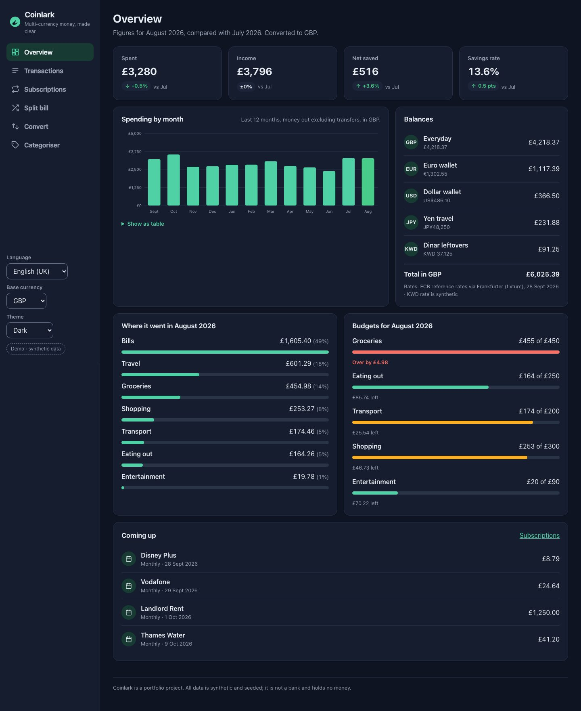
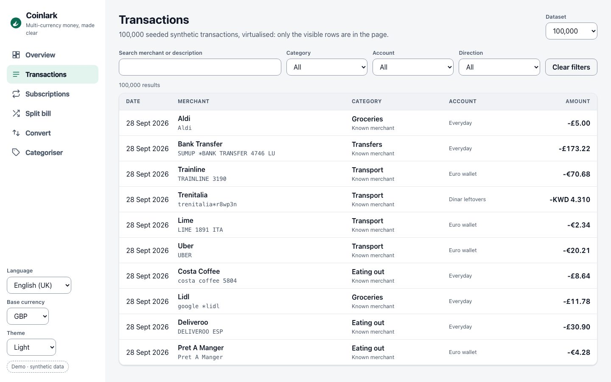
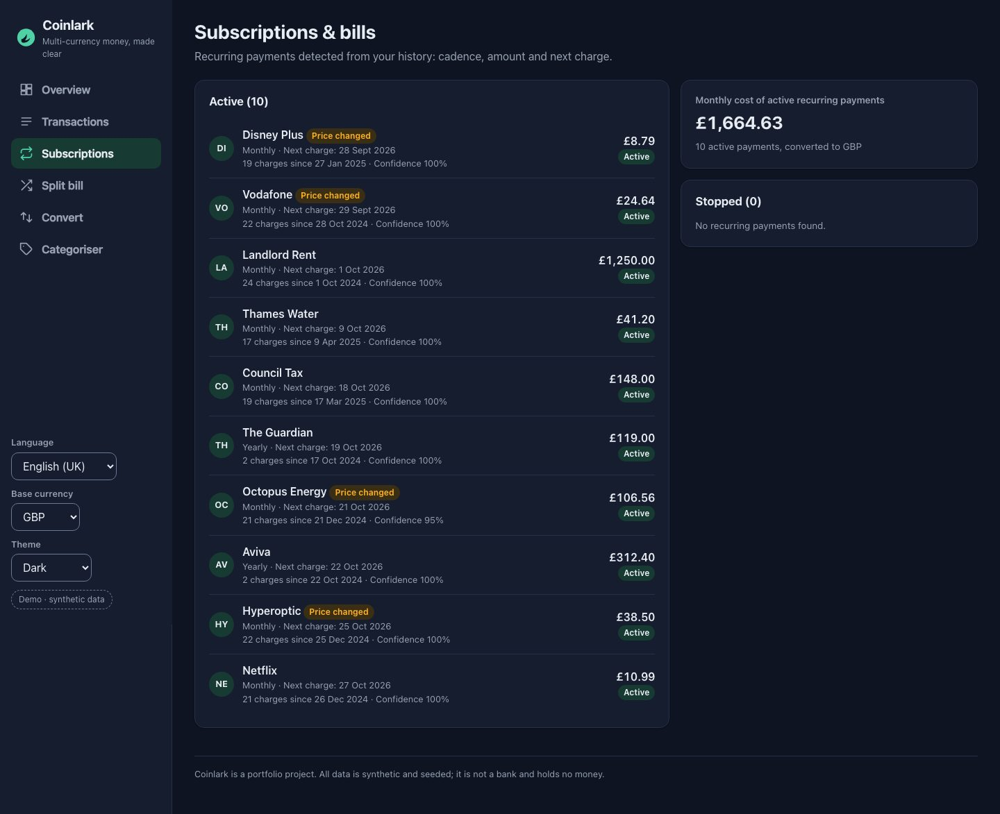
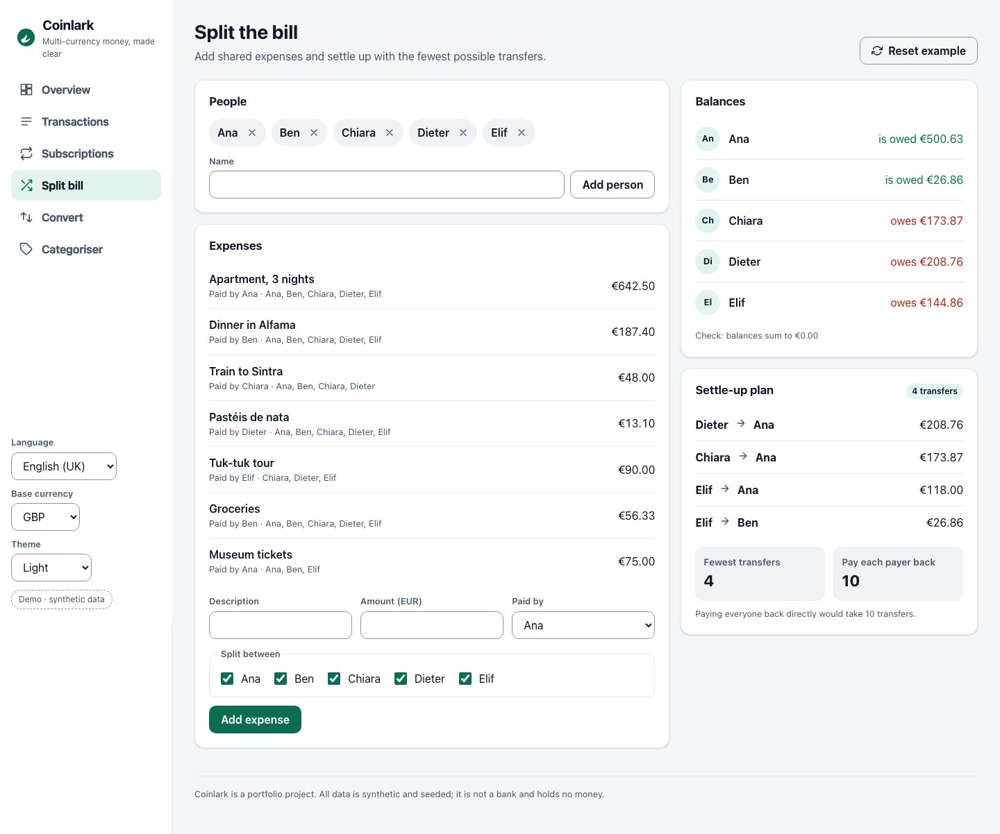
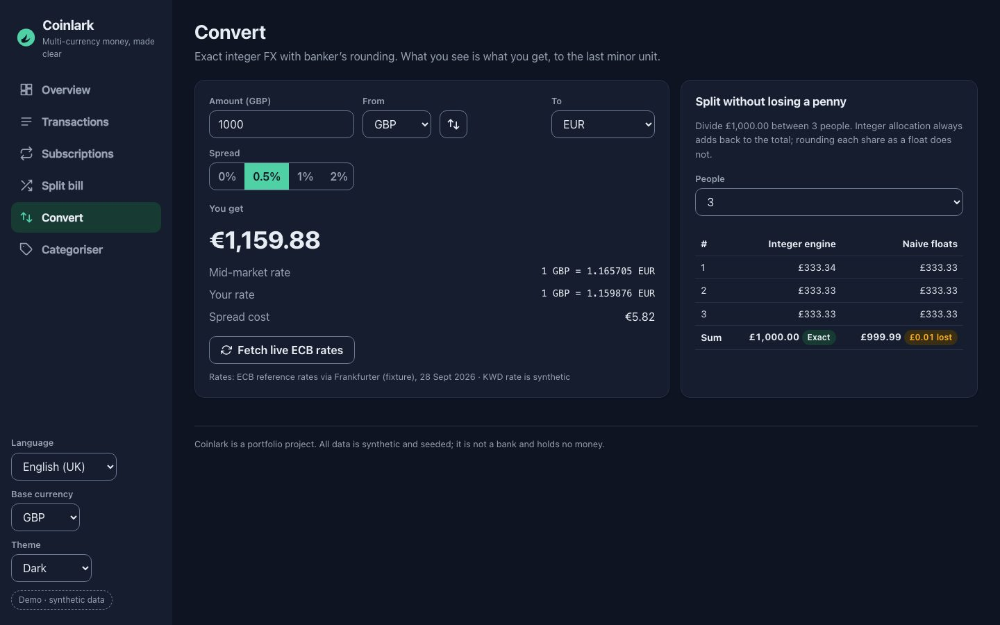
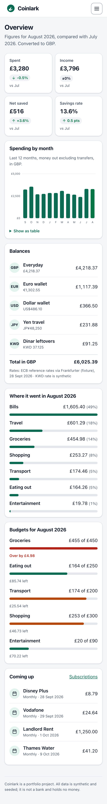
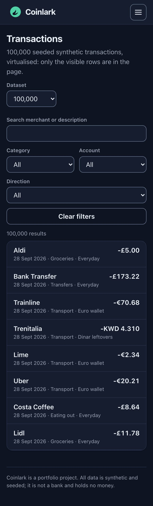
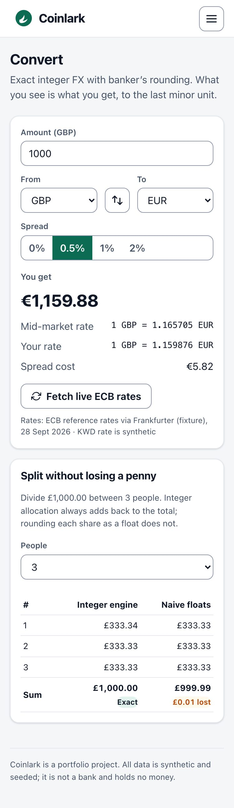

# Coinlark

**A multi-currency money app with exact money maths.** Coinlark holds balances in GBP, EUR, USD, CHF, JPY and KWD,
converts between them with a transparent spread, turns messy card descriptors into merchants and categories, finds
your subscriptions, splits group bills with the fewest transfers and shows how this month compares with the last,
in English, Italian, Spanish or German.

Built as a portfolio piece for fintech frontend roles with React 18, TypeScript (strict), Vite, Vitest, fast-check and
Playwright. Every feature solves a concrete problem and is **measured against the naive approach**. Every number
below comes from a script in this repo and is written to [`reports/results.json`](reports/results.json).

> **Disclaimer:** Coinlark is not a bank, holds no money and is not affiliated with any bank or brand. **All data is
> synthetic and seeded** (seed `20260929`, synthetic "today" 2026-09-28). Merchant names are used only as realistic
> descriptor strings. FX rates are ECB reference rates for 2026-09-28 fetched once from api.frankfurter.app and
> bundled as a fixture; the KWD rate is synthetic (the ECB does not publish it) and is labelled as such in the UI.



## Headline results

| Problem                                                                   | Coinlark                                                                    | Naive baseline                                                                                                  | Source             |
| ------------------------------------------------------------------------- | --------------------------------------------------------------------------- | --------------------------------------------------------------------------------------------------------------- | ------------------ |
| Splitting amounts (1,000,000 seeded splits, 6 currencies)                 | **0 minor units lost**                                                      | floats: 767,538 units lost across 571,547 splits                                                                | `money.split`      |
| FX conversion (1,000,000 seeded conversions vs an exact BigInt reference) | **0 wrong**                                                                 | floats: 183 wrong even by their own half-up rule (346 vs banker's)                                              | `money.conversion` |
| Merchant categorisation (10,000 held-out messy descriptors)               | **97.9% accurate** (99.7% known, 90.4% unseen)                              | word-boundary keywords: 71.9%; 93% fewer errors                                                                 | `categorise.test`  |
| Subscription detection (300 held-out users, 2,700 planted series)         | **precision 99.3%, recall 99.4%**; next charge within ±3 days 96.1%         | same amount ≥3 times: precision 78.2%, recall 89.6%                                                             | `recurring.test`   |
| Settle-up (1,000 seeded groups of 3–12 people)                            | **6.54 transfers/group, 73% fewer**; 1,000/1,000 groups settle to exactly 0 | pay each payer back: 24.00 (greedy 6.54)                                                                        | `settle.random`    |
| 100,000-row transaction feed                                              | **344 DOM nodes, 39 ms render, 32 ms filter (median)**                      | non-virtualised, 10k rows: 110,146 nodes, 1,066 ms, 284 ms; 100k rows: 1.1M nodes, 12.8 s render, 16.3 s filter | `feed.headline`    |
| Accessibility (6 pages × light/dark × desktop/mobile)                     | **0 axe violations** in 24 scans (WCAG 2.2 AA tags)                         | n/a                                                                                                             | `a11y`             |
| Bundle                                                                    | **54.0 KB gzip main chunk**, 73.1 KB initial (budget 80 / 110)              | n/a                                                                                                             | `bundle`           |

What didn't win, reported honestly:

- **Round trips and running balances:** floats did just as well here. Both lose at most 2 minor units on an A→B→A round
  trip (both must round in the middle currency), and a 1,000,000-posting float balance showed 0 drift once rounded.
  The engine's advantage is in splitting and conversion correctness, not here.
- **Exact vs greedy settle-up:** exact minimum transfers beat the simple greedy method in only 2 of 1,000 random groups
  (16 of 1,000 when everyone pays whole €10 bills). Almost all the gain comes from netting balances at all.
- **Filter latency** is about 32 ms at every feed size because the input is deferred (`useDeferredValue`) and measured
  to the painted frame: roughly two frames, not raw filtering time.
- The 100,000-row generation and categorisation takes about 0.6 s on first load of the feed (shown as a loading state).

Full traceability (requirement → tests → number): [`docs/EVIDENCE.md`](docs/EVIDENCE.md).

## Features

| Page              | What it does                                                                                                                                                                                                                                 |
| ----------------- | -------------------------------------------------------------------------------------------------------------------------------------------------------------------------------------------------------------------------------------------- |
| **Overview**      | KPI tiles (spent, income, net, savings rate) vs the previous month · 12-month spending chart with a data table · spending by category · budgets with ok/warning/over states · all balances totalled in your base currency · upcoming charges |
| **Transactions**  | 100,000 seeded transactions, virtualised, with search, category/account/direction filters and an empty state                                                                                                                                 |
| **Subscriptions** | Detected recurring payments: cadence, amount, next charge, price-change flag, active/stopped, monthly total                                                                                                                                  |
| **Split bill**    | People and expenses with validation, balances, the minimum set of transfers, and the pairwise count for comparison                                                                                                                           |
| **Convert**       | Exact FX with 0 / 0.5 / 1 / 2% spread, mid vs customer rate, fee; "split without losing a penny" engine-vs-float demo; optional live ECB rates                                                                                               |
| **Categoriser**   | Type any descriptor and see normalisation, merchant, match method, confidence and the naive answer                                                                                                                                           |

Everything works offline, in four languages (en-GB, it-IT, es-ES, de-DE), in light, dark or system theme, and down to 375 px.

|                                                          |                                                           |
| -------------------------------------------------------- | --------------------------------------------------------- |
|  |  |
|                |              |

| Mobile (375 px)                                                |                                                                       |                                                              |
| -------------------------------------------------------------- | --------------------------------------------------------------------- | ------------------------------------------------------------ |
|  |  |  |

## Architecture

```
src/pages ─► src/components ─► src/state (settings, router, data)
                  │
                  ▼  pure functions only
src/lib/  money · categorise · recurring · settle · insights · feed · i18n · data
```

- **Money is never a float.** `Money { amount: safe integer of minor units, currency }`; arithmetic in `bigint`;
  rates are exact rationals; banker's rounding by default; `allocate` uses the largest-remainder method;
  formatting passes the exact decimal string to `Intl.NumberFormat`.
- **Categoriser:** normalise → exact knowledge-base match → Jaro–Winkler fuzzy match (≥ 0.90) → multilingual,
  typo-tolerant keyword rules → "General". Tuned on a dev seed, reported on a separate test seed.
- **Recurring detection:** group by merchant → cluster by amount (allowing price rises) → find weekly/monthly/yearly
  chains that tolerate failed collections → filter on coverage, fill and price stability → next due date.
- **Settle-up:** exact minimum transfers via dynamic programming over subsets (max number of zero-sum subgroups), greedy fallback above 16 people.
- **Feed:** a hand-written fixed-height virtual list with ARIA table semantics, a pre-lower-cased search index and `useDeferredValue`.

More in [`docs/ARCHITECTURE.md`](docs/ARCHITECTURE.md). The project was built spec-first: [`.kiro/`](.kiro) has
steering docs, four specs with EARS acceptance criteria, design notes and traced task lists, agent hooks and
[`evidence.yml`](.kiro/evidence.yml).

## Run it

```bash
npm ci
npm run dev            # http://localhost:5190
npm test               # 142 unit, property and component tests
npm run coverage       # ≥ 90% gate on src/lib (currently 99.9% lines)
npm run e2e            # Playwright, desktop + mobile, incl. axe (needs Chromium: npx playwright install chromium)
npm run build && npm run preview   # http://localhost:5191
npm run bench          # money / categorise / recurring / settle benchmarks → reports/parts/*.json
npm run bench:feed     # virtualisation + web-vitals measurements (~4 min; the 100k non-virtual baseline is slow)
npm run evidence       # all of the above → reports/results.json, reports/evidence.json, docs/EVIDENCE.md
npm run screenshots    # docs/screenshots/*.jpg (after a build)
```

Useful URLs: `#/transactions?n=10000&virtual=0` (non-virtualised baseline), `?lang=de-DE`, `?theme=dark`.

## Quality

- TypeScript strict (+ `noUncheckedIndexedAccess`), ESLint (typescript-eslint strict, react-hooks, jsx-a11y strict) and Prettier: clean.
- 142 Vitest tests (unit, fast-check properties, React Testing Library): 99.87% line / 96.3% branch coverage on `src/lib`.
- 51 Playwright checks passing on desktop 1440×900 and mobile 375×812 (1 keyboard-only test is skipped on mobile):
  every page, navigation, keyboard and skip link, locale/currency/theme switching, no console errors, no horizontal scroll, no `NaN`.
- axe-core: 0 violations. Lab web vitals on the overview page: LCP 44 ms, CLS 0 (local, unthrottled, so optimistic).
- GitHub Actions: lint → typecheck → unit (coverage gate) → e2e → build (bundle budget).

## Limitations

- Synthetic data only; the categoriser's accuracy on real bank descriptors is unmeasured and would be lower.
- The recurring detector assumes subscriptions charge a (nearly) fixed price; variable bills (e.g. metered energy) are out of scope.
- Performance numbers are lab measurements from one machine in headless Chromium without throttling; field data and low-end devices would be slower.
- The 100k non-virtualised baseline was measured once with 6 filter samples (it takes minutes); the other configurations use 3 loads and 20 samples.
- No backend, auth or persistence beyond local preferences; the live-rates button is the only network call.
- Not audited with real assistive-technology users; accessibility evidence is automated (axe) plus keyboard e2e.

## Licence

MIT © 2026 Pablo Williams
